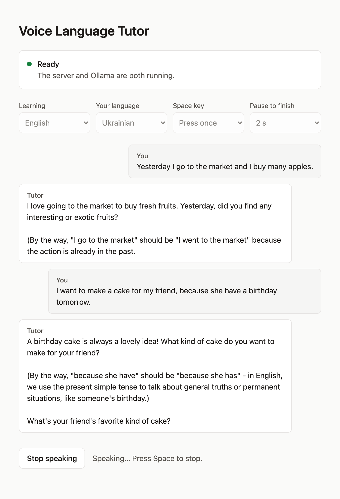
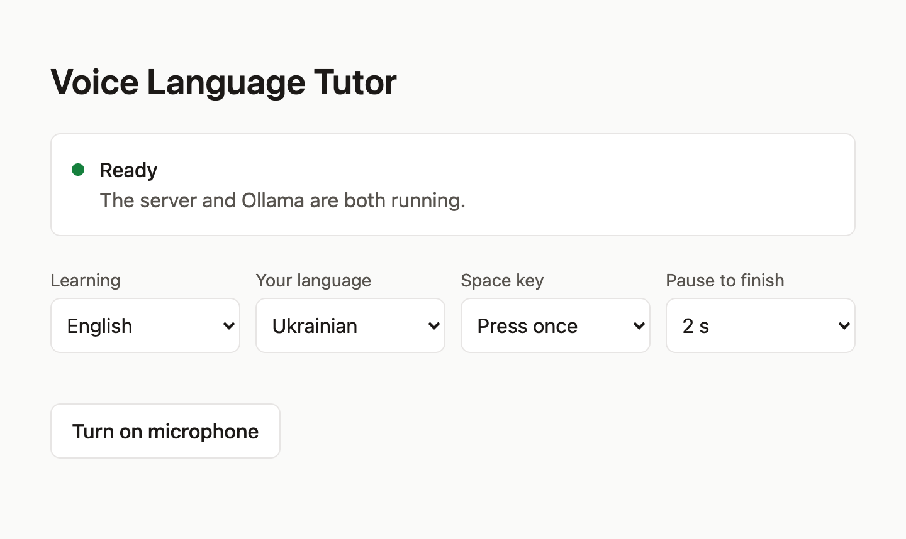
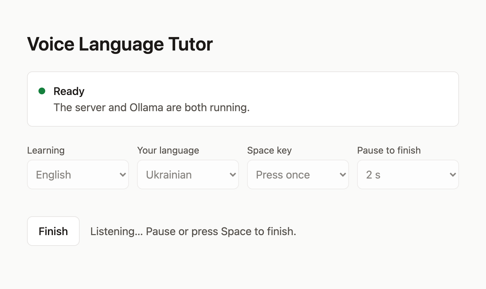

# Voice Language Tutor (local)

You speak out loud in the language you are learning → the AI hears you, replies by voice
and politely corrects your mistakes. It runs in your browser, and speech recognition and the
language model run on your computer.



Tested in Chrome on macOS. Firefox, Safari, Linux and Windows haven't been tested yet.

## What it's made of

- **faster-whisper** — recognizes your speech (speech-to-text), locally
- **Ollama** — a local language model that holds the conversation and corrects mistakes
- **The browser's speech synthesis** — reads the reply aloud in a system voice
- **FastAPI** — the local server that connects these and serves the page
- **React, TypeScript, Vite** — the web page

## Setup

You need [Python](https://www.python.org/downloads/) 3.10 or newer,
[Node.js](https://nodejs.org) 20.19+ or 22.12+, and [Ollama](https://ollama.com).

1. Download the language model (~4.7 GB, once). If your computer is less powerful, use a
   smaller model such as `llama3.2` (~2 GB) and change `OLLAMA_MODEL` in `server.py`.
   ```
   ollama pull llama3.1
   ```
2. Install the Python libraries, from the project folder:
   ```
   python -m venv venv
   source venv/bin/activate
   pip install -r requirements.txt
   ```
3. Build the web page:
   ```
   cd web
   npm install
   npm run build
   cd ..
   ```

Build the page again after changing anything in the `web` folder.

## Run it

Make sure Ollama is running, then start the server from the project folder:

```
source venv/bin/activate
python server.py
```

Open http://127.0.0.1:8000. The first start also downloads the Whisper model (~500 MB, once).

## Using it

1. Click **Turn on microphone** and allow access. Stay quiet for half a second while the page
   measures background noise.

   

2. Press **Space** and speak. Recording stops after a pause, or right away if you press
   **Space** again. If you say nothing for 8 seconds, the recording is cancelled.

   

3. Your words appear, then the tutor's reply, which is also read aloud. Press **Space** to stop
   the voice.

Recording stops at 60 seconds at most. The conversation is kept only until you reload the page.

### Settings

Settings are saved in your browser.

| Setting | What it does |
| --- | --- |
| Learning | The language the tutor speaks with you |
| Your language | The language it can use to explain mistakes |
| Space key | **Press once**: recording ends after a pause. **Hold down**: recording lasts while you hold Space |
| Pause to finish | How long a silence ends the recording, in **Press once** mode |

Replies are read in the voice for the alphabet they're written in. If both of your languages use
the same alphabet, such as English and Spanish, the whole reply is read in the voice of the
language you're learning.

### Privacy

Your speech and the conversation stay on your computer. The exception is reading aloud if your
system has no local voices: the browser may then use an online voice, which sends the reply's
text to that voice's provider.

## Developing the page

Run the server and Vite's development server in two terminals. The page then updates as you edit:

```
python server.py
```
```
cd web
npm run dev
```

Open http://localhost:5173.

## Console version

`main.py` is the same tutor without the web page, for macOS and Linux. Run it in a regular terminal:

```
python main.py --target English --native Ukrainian
```

Press **Space** to speak and `q` to quit. Optional parameters:

- `--target` — the language you are learning (default "English")
- `--native` — your native language (default "Ukrainian")
- `--model` — Ollama model name (default "llama3.1")
- `--whisper-size` — tiny / base / small / medium / large-v3 (accuracy vs speed)
- `--silence` — how many seconds of silence end the recording (default 2)
- `--max-duration` — maximum recording length in seconds (default 60)
- `--threshold` — voice loudness threshold (determined automatically from background noise by default)

On Linux, reading aloud uses `espeak`: `sudo apt install espeak`.

## Common problems

**"The web page isn't built yet", or the address shows `{"detail":"Not Found"}`**
→ Build the page (Setup, step 3), then restart the server.

**"Ollama isn't running"**
→ Open the Ollama app, or run `ollama serve` in a separate terminal and leave it open.

**"The server isn't running"**
→ This appears in development mode. Run `python server.py` in the project folder.

**"Microphone access is blocked"**
→ Allow the microphone in the browser's site settings, then click **Turn on microphone** again.
If that doesn't help, also check your operating system's privacy settings for the browser.

**Recording cuts off while you're thinking**
→ Choose a longer **Pause to finish**, or set **Space key** to **Hold down**.

**Recording doesn't stop**
→ Background noise may sound like speech. Reload the page and keep quiet while it measures the
noise, or set **Space key** to **Hold down**.

**No voice for a language**
→ Add that language's voice in your operating system's speech settings, then reload the page.

**Whisper is slow**
→ Use a smaller model: change `WHISPER_SIZE` in `server.py` to `tiny` or `base`.
If you have an NVIDIA graphics card with CUDA, you can speed it up by changing
`device="cpu"` to `device="cuda"` in the code (requires the CUDA toolkit to be installed).

## What could be improved next

- More reliable end-of-phrase detection using real voice activity detection (VAD)
  instead of a loudness threshold
- A better voice using a local neural TTS (for example Piper) instead of
  the system voice
- Saving conversation history to a file to see your progress
- Highlighting corrections in a separate color in the output
